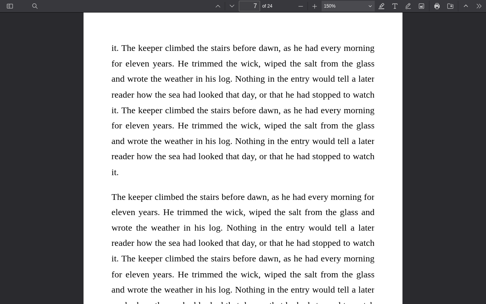
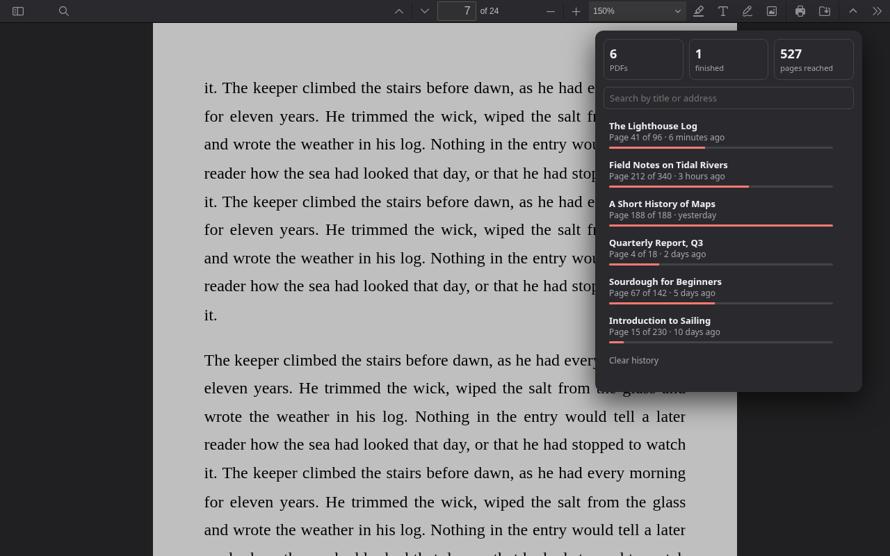
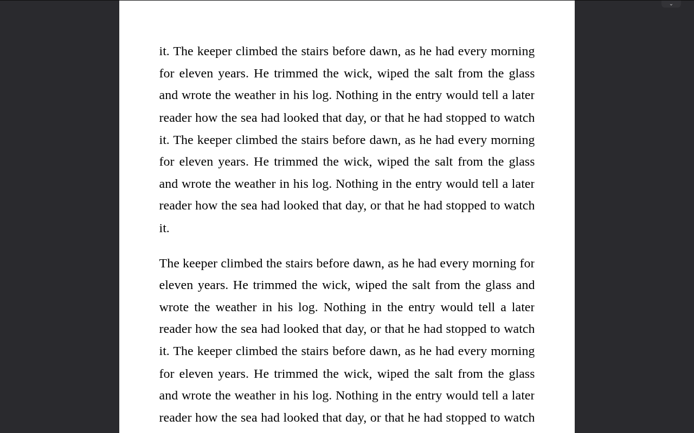

# Dogear

A Chrome extension that opens every PDF where you left off.

Chrome's built-in viewer forgets your place when you close a tab. Dogear shows PDFs in [PDF.js](https://github.com/mozilla/pdf.js) and saves your position as you read. There's no account, no server and no analytics.



The toolbar icon shows what you've been reading and how far you got:



Press `T` to hide the toolbar and leave just the page:



## Features

- **Remembers your place:** page, position on the page, zoom and rotation, for PDFs on the web and on your computer. A renamed or moved file keeps its place.
- **History:** the toolbar icon lists your PDFs with their progress. Clicking one switches to its tab or reopens it.
- **Sensible zoom:** new PDFs fit the window width, up to 150%, or use the zoom you last picked. `Ctrl+0` resets it.
- **Page numbers your way:** when a book's printed numbers differ from the file's, a button switches between them.
- **Distraction-free reading:** `T` hides the toolbar. Point at the top edge of the window to bring it back.
- **Survives updates:** Chrome closes extension tabs when an extension updates, so Dogear reopens them in their tab groups.

## Install

From the Chrome Web Store, or from source:

```sh
npm install
npm run build
```

Then open `chrome://extensions`, turn on **Developer mode**, click **Load unpacked** and select `dist/`.

To use Dogear with PDFs on your computer, open its **Details** and turn on **Allow access to file URLs**.

## Good to know

- A `#page=N` link wins over the saved position.
- Downloads, POST responses and PDFs embedded in pages stay with Chrome.
- Positions aren't saved in incognito.
- Documents are told apart by a fingerprint from the PDF itself, so two PDFs with the same internal ID share a position.
- If a PDF won't load, the `»` menu has **Open in Chrome's viewer**.

## Privacy

Everything stays on your device. See the [privacy policy](PRIVACY.md).

## Development

```sh
npx puppeteer browsers install chrome
npm test           # end-to-end tests in Chrome for Testing
npm run package    # builds dogear-<version>.zip for the Web Store
```

To test another Chrome version, set `PUPPETEER_EXECUTABLE_PATH`. PDF.js is downloaded at build time, pinned by version and SHA-256 in `scripts/build.mjs`.

## License

[Apache-2.0](LICENSE), the same as the bundled PDF.js.
